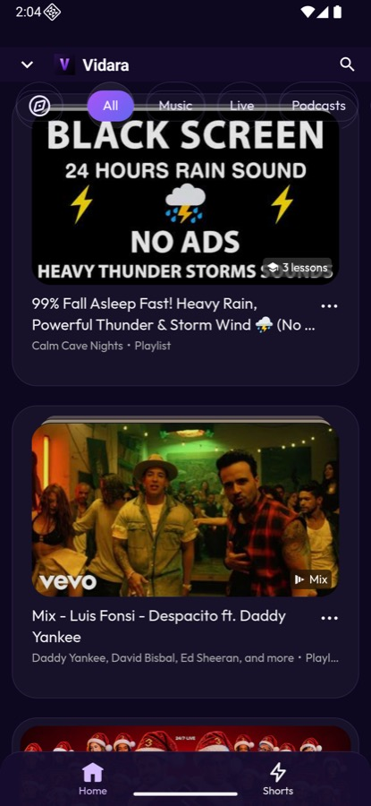
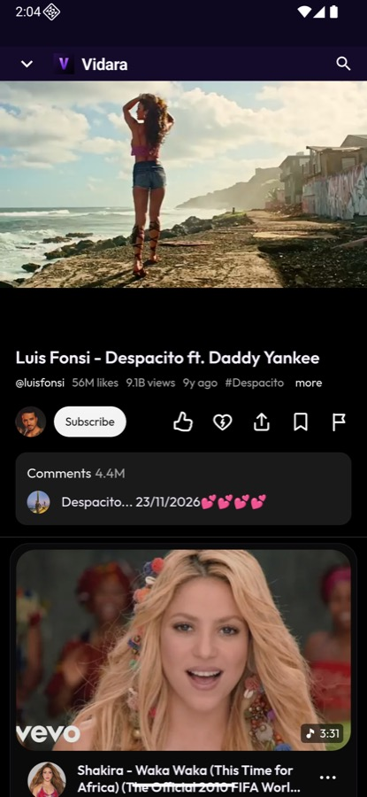
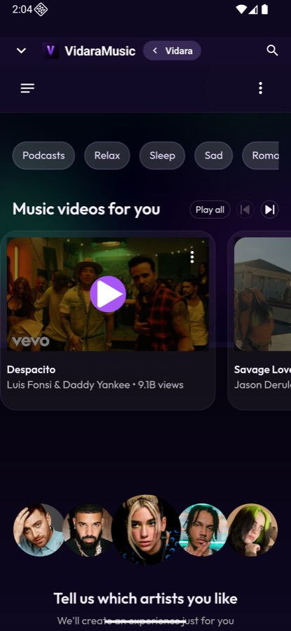
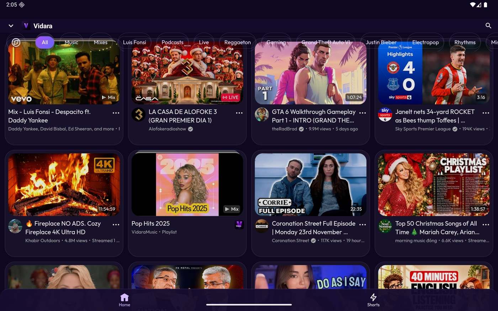
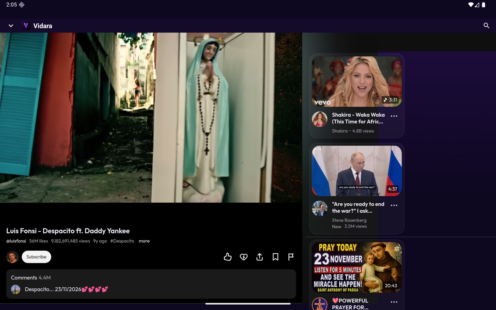
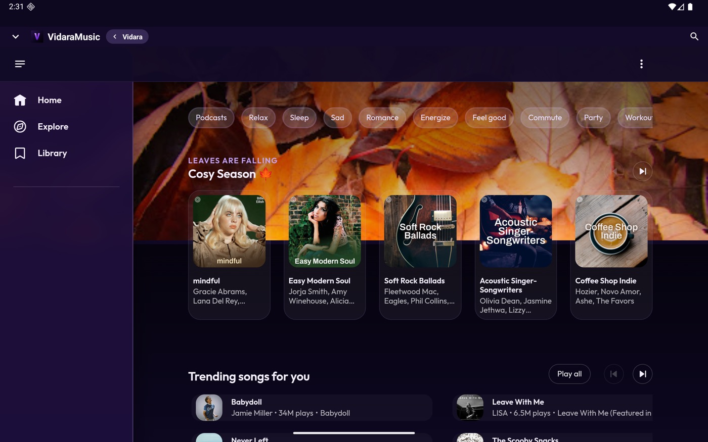

# Vidara

**Ad-free YouTube and YouTube Music in one Android app — with a real glass-purple interface of its own.**

Vidara shows the real web player inside a single, fast WebView and takes the ads, the clutter and the
Google branding out of it. No account, no server, no tracking — playback runs on your own connection.

<p align="center">
  
  
  
</p>

<p align="center"><em>Phone: feed, video page and VidaraMusic</em></p>

## Tablet and foldable

On larger screens Vidara fills the display: a four-column feed, full-width rows, and a two-pane video page
(player on the left, related videos on the right). Everything is measured so no empty band is left on the
screen — from a 320 dp phone to a 1280 dp tablet.

<p align="center">
  
  
</p>

<p align="center"><em>Tablet: filled grid and the two-pane video page</em></p>

<p align="center"></p>

## Features

- **No ads.** The real player runs with ad-free requests; anything that slips through is skipped automatically.
- **VidaraMusic.** Songs, albums and radio in the same app — the compass icon next to the chips opens it,
  with its own logo, colours and player bar.
- **Shorts.** Swipe up for the next short; the bottom bar only ever has Home and Shorts.
- **Own interface.** Glass-purple theme, custom icons, Vidara lettering everywhere — no YouTube logos or menus.
- **Every screen size.** One column on phones, a filled grid on tablets, and a two-pane video page from
  820 dp. Rotating the device keeps the same layout.
- **Send feedback to Vidara / Vidara Help.** Both menu entries are Vidara's own dialogs. Feedback goes
  straight to the developer's mailbox with the app version, Android version, device and page attached —
  never to Google.
- **Self-update.** The app checks GitHub Releases and installs the newest APK in place; your settings and
  history stay.
- **Light and quick.** Timers pause in the background, full-page scans are throttled, and the player is
  sized natively instead of being re-laid out on every frame.

## Install

1. Open **[Releases](../../releases/latest)** and download `Vidara-v1.0.apk`.
2. Allow installing from this source when Android asks.
3. Open Vidara — the feed loads immediately, nothing to sign in to.

Requirements: Android 8.0 (API 26) or newer. Tested on Android 15/16/17 phones, tablets and foldables.

## Update

Inside the app: **You → Search for updates** (or wait for the automatic check every six hours).
Updates install over the existing app, so your data stays.

## Build from source

```bash
cd android
./gradlew :app:assembleDebug          # APK: app/build/outputs/apk/debug/app-debug.apk
adb install -r app/build/outputs/apk/debug/app-debug.apk
```

Kotlin, plain Android SDK, no third-party runtime dependencies. The whole web layer lives in
`android/app/src/main/java/com/rik/vidaraplus/WebTube.kt`.

## Privacy

No analytics, no crash reporting, no Vidara server. Playback happens in the real player on your own
connection; the only network calls the app makes besides playback are the GitHub release check.

## Notes

Vidara is an independent client and is not affiliated with Google or YouTube. It renders the public web
player; nothing is downloaded or re-hosted.
